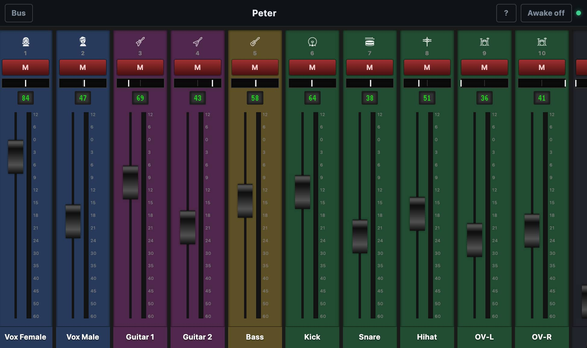

# X32 Personal Mix

Go web app for personal submix control of a Behringer X32 / Midas M32 over OSC. The server runs on the local network; browsers on iPhone, Android, and tablets connect via HTTP/WebSocket.

In mix mode: **fullscreen submix mixer** — **each browser has its own session** (its own submix bus).



## Current status

**v0.4.0** — Bus picker with desk color/icon; refreshed PWA icon (headphones + fader).

- Automatic discovery (`/xinfo`) or fixed address via `-mixer`
- Choose stereo buses (odd 1–15) — **independently per client**; bus list is re-read from the X32 on every pick and shows each bus’s **color** and **icon**
- **PWA**: fullscreen/standalone (no browser chrome), install icons, service worker
- Screen stays awake (Screen Wake Lock + iOS/HTTP fallback) for long-running use
- Fullscreen submix: CodePen-style strips, dB fader scale (+10…−60), LED in dB, live meters with peak hold, mute **M**, pan (tap → full-width); channel color as strip background
- Optional **Master** strip (sticky right): bus output fader/pan/mute/meter/icon while channels scroll
- Optional **VU** meter ballistics; channel icons as white X32 PNGs
- Live updates from the desk via `/xremote` (only sessions using the affected bus)
- Channel / bus levels from the X32 via `/meters/0`
- Fader height adapts to the screen; iPhone portrait chrome sits below the notch

## Quick start

```bash
go run ./cmd/server
go run ./cmd/server -mixer 192.168.1.10
go run ./cmd/server -domain mixer.myband.com -mixer 192.168.1.10
MIXER=192.168.1.10:10023 DOMAIN=mixer.myband.com go run ./cmd/server
```

Default: **HTTPS** on `:8443` (self-signed cert in `.x32-personal-mix-tls/`), HTTP `:8080` redirects there.

- `https://localhost:8443` or `https://<LAN-IP>:8443`
- with `-domain mixer.myband.com`: cert includes that DNS name → `https://mixer.myband.com:8443` (DNS/hosts must point at the server)
- `http://…:8080` → redirect to HTTPS

```bash
go test ./...
go build -o x32-personal-mix ./cmd/server
```

## Cross-build (Dagger)

Release binaries for common platforms (requires Docker + [Dagger](https://dagger.io)):

| OS | Architectures |
|----|----------------|
| Linux | `amd64`, `arm64`, `386`, `armv7` |
| Windows | `amd64`, `arm64`, `386` |
| macOS | `amd64` (Intel), `arm64` (Apple Silicon) |

```bash
# List targets
dagger call targets

# Tests + all binaries into ./dist
dagger call check export --path=./dist

# Build only
dagger call build export --path=./dist
```

CI ([`.github/workflows/ci.yml`](.github/workflows/ci.yml), Dagger **v0.21.10**):

- **Push / PR** (no version tag): runs tests only (`dagger call test`)
- **Version tag** (`v*`, e.g. `v1.0.0`): runs tests + cross-build and publishes a GitHub Release with the binaries

```bash
# After bumping VERSION + CHANGELOG (see CHANGELOG.md)
git tag -a v0.4.0 -m "v0.4.0"
git push origin v0.4.0
```

## Architecture

```
Browser A (Bus 1) ─┐
Browser B (Bus 5) ─┼─ HTTP/WS ─► Go server ─ UDP OSC ─► X32
Browser C (Bus 3) ─┘                 ▲ /xremote
```

Session ID and **last selected mix** live in `localStorage` (`x32mix_sid`, `x32mix_bus`) and are restored on reopen.

| Path | Role |
|------|------|
| `cmd/server/` | HTTP server, flags |
| `internal/osc/` | OSC + background reader |
| `internal/x32/` | Discovery, buses, submix, icons, colors, updates |
| `internal/hub/` | Global mixer connection + **per-browser sessions** |
| `internal/api/` | REST + `/xremote` |
| `web/` | Fullscreen UI |

## Flow

1. Client connects → own session.
2. Server connects once to the X32; everyone sees the bus list.
3. Each client picks **their** submix bus.
4. Fader/pan/mute affect the X32; live updates reach only clients on the same bus.

## API (short)

Control endpoints should send header `X-Session-ID` when possible (otherwise a new one is issued).

| Endpoint | Purpose |
|----------|---------|
| `GET /ws?sid=` | Live status for the session |
| `POST /api/select-bus` | `{ "bus": 1 }` — this session only |
| `POST /api/clear-bus` | Clear this session’s bus selection |
| `POST /api/level` / `pan` / `mute` | Send on the **session’s bus** |
| `POST /api/discover` | Reconnect to X32 (global) |

Phases (per session view): `idle` → `searching` → `connected` → `mixing` (or `error`).

## OSC

- `/xinfo`, `/xremote`
- `/meters` → `/meters/0` (channel level blob)
- `/bus/XX/config/name|icon|color`
- `/bus/XX/mix/fader|on|pan`
- `/ch/XX/config/name|icon|color` (icon 1–74 → `/icons/{n}.png`)
- `/ch/XX/mix/BB/level|on|pan`

## Flags

| Flag / Env | Meaning |
|------------|---------|
| `-https` / `HTTPS` | HTTPS listen (default `:8443`, `off` = HTTP only) |
| `-http` / `ADDR` | HTTP listen, redirect → HTTPS (default `:8080`) |
| `-domain` / `DOMAIN` | Hostname in the certificate (e.g. `mixer.myband.com`) — optional |
| `-tls-dir` / `TLS_DIR` | Certificate directory (default `.x32-personal-mix-tls`) |
| `-mixer` / `MIXER` | `host` or `host:port` — skip discovery |

### Domain & certificate (LAN)

`-domain` adds the name as a DNS SAN on the **self-signed** certificate (the server still listens on all interfaces; DNS or hosts must resolve the name to the LAN IP). If the existing cert lacks the name, it is regenerated.

**Let's Encrypt** cannot issue a phone-trusted cert for pure LAN names like `mixer.myband.com`: it needs a publicly resolvable domain and an ACME challenge (HTTP from the internet or DNS-01). Without that, the cert stays self-signed — accept once, or trust a local CA on the device (e.g. [mkcert](https://github.com/FiloSottile/mkcert)).

## PWA / home screen / stay awake

1. Start the server (HTTPS is default):
   ```bash
   go run ./cmd/server -mixer 192.168.1.10
   ```
2. On iPhone open `https://192.168.x.x:8443` (or HTTP — redirected) → accept the certificate once (“Continue”).
3. Share → “Add to Home Screen” → launch the app from there.
4. Tap **Awake on** (Wake Lock).

**Icons:** Android uses `manifest.json` (`icon-192-v33.png` / `icon-512-v33.png`). iOS uses `apple-touch-icon` in `index.html` (`apple-touch-icon-v33.png`) — not the favicon. If the home-screen icon is only a letter **X**, Safari often failed to load the PNG (e.g. self-signed cert) and fell back to the first letter of the title; trust the cert, open `/apple-touch-icon-v33.png` once, remove the old icon, then add again.

Fallback: Settings → Display & Brightness → **Auto-Lock → Never**.

## Notes

- One X32, many independent submix sessions
- Channel icons: full X32 set (indices 1–74) as white PNGs from [behringer-icons](https://github.com/mamarguerat/behringer-icons) BMPs (GPL-3), served as `/icons/{n}.png`
- Mixer bar toggles (persisted): **Master**, **VU**, **Awake**
- No authentication (LAN)

## Changelog

See [CHANGELOG.md](CHANGELOG.md).
